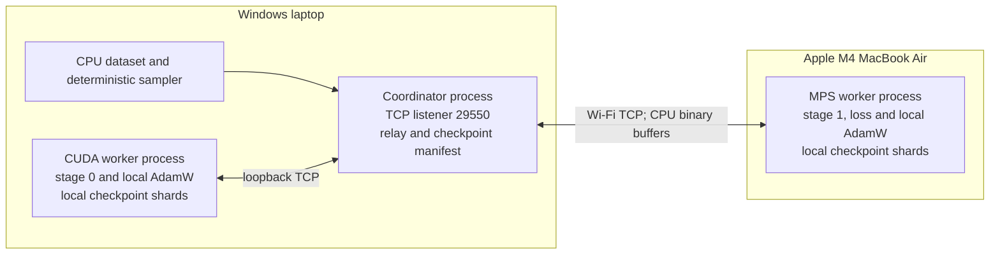

# Runtime architecture

Status: target architecture with [M1](M1.md) model/reference, [M2](M2.md) transport/state primitives and [M3](M3.md) serial training implemented. CPU process tests pass; target-hardware acceptance and M4 durable checkpoints remain pending. Read [PROTOCOL.md](PROTOCOL.md) for normative messages and barriers, [FEASIBILITY.md](FEASIBILITY.md) for budgets, and [VALIDATION.md](VALIDATION.md) for acceptance tests. API evidence below was accessed 2026-10-07.

## Processes and responsibilities



The coordinator owns run configuration, membership, step and parameter versions, deterministic data order, scheduling, scalar metrics, timeouts and the small checkpoint manifest. It never owns a full training model or optimizer. It binds one IPv4 listener to 0.0.0.0:29550 with scoped firewall access; both workers initiate one persistent connection (CUDA via loopback, Mac via the Windows LAN IP). The coordinator relays stage tensors; this adds Windows CPU/loopback copies but does not send each tensor twice over Wi-Fi. Direct worker-to-worker transport is deferred until profiling establishes a need.

Each worker has one device-compute thread and a small socket I/O loop/thread with bounded queues. Only the compute thread mutates model/optimizer state. The I/O path serializes all writes and reports heartbeats even while device operations run; progress deadlines still catch hung compute. Explicit device placement is mandatory. No torch.distributed process group, NCCL, Gloo accelerator collective, RPC distributed autograd, or MPS collective is required.

Discovery reports OS/architecture, Python and exact PyTorch build, CUDA driver/runtime or macOS version, accelerator identity, available-device checks, memory observations, diagnostic result and fallback configuration. CPU probes support debugging, but a performance run rejects a worker that cannot complete required operations on its declared accelerator. macOS unified-memory budgets include the OS and CPU allocations; Windows host RAM is separately budgeted from VRAM.

## Model and state ownership

The [reference workload contract](PROJECT_SPEC.md#reference-workload-contract) is authoritative for exact dimensions, operation choices, hyperparameters and batch settings. It uses a small pre-LayerNorm decoder with learned token/position embeddings, explicit causal attention, GELU, zero dropout and FP32 throughout. Avoid fused attention and custom kernels. Byte-tokenized data is sufficient for initial real-text runs; the synthetic fixture uses the same vocabulary.

The current evaluation identifier is `decoder_v2` (2026-10-20). Its key projection evaluates `linear(x, weight, bias * 0.0)`: the softmax-invariant row shift is cancelled before floating-point score computation. Key bias remains an owned parameter with a present exact-zero autograd gradient and normal AdamW state/weight decay. No gradient filtering is applied. See PROJECT_SPEC and decision D15 for the derivation and limits. This evaluation revision is shared by all devices and the reference; the architecture identifier changes the configuration hash and rejects mixing with `decoder_v1`, including old diagnostic snapshots. The transport frame version remains 1. Copy the same updated source to both machines and start fresh runs.

For split `k` of `L` blocks, stage 0 owns token/position embeddings and blocks `[0,k)`; stage 1 owns blocks `[k,L)`, final norm and the untied output head. Valid search points are `1..L-1`. Global parameter names encode block index and never depend on the split. Each parameter and its gradient, Adam first/second moments and scalar step counter has exactly one owner. No replicated trainable weights and no weight tying cross the cut. AdamW uses `foreach=False`, `fused=False`; the reference uses identical grouping and hyperparameters from the specification.

An explicit `--adam-eps` experiment is selected by the coordinator, validated as positive/finite, and included in the existing optimizer configuration/hash. Both workers construct AdamW from that shared config; snapshot reference replay reads the same epsilon. Workers have no independent override. M1 applies its explicit epsilon to both split and unsplit trainers. Default epsilon remains 1e-8; changed-epsilon acceptance and quality/baseline results are recorded separately (D16).

Model configuration, parameter specification, optimizer policy, data version and initialization algorithm are hashed into `config_hash`. Each worker constructs only its local modules. To obtain partition-independent initialization, derive a per-parameter seed from SHA-256 of UTF-8 `hive-train:init:v1:<decimal_master_seed>:<global_parameter_name>`, interpret the first eight digest bytes as unsigned big-endian, and mask to 63 bits. Generate one named tensor at a time with a CPU generator and the distributions in the specification. Copy it to its owning device, then release staging storage. Override all module-default initialization. The single-device reference follows the same process. M1 freezes canonical parameter names and a small CPU fixture before comparative tests. A common seed alone with different module construction orders is insufficient.

## Batch and autograd contract

Windows holds downloaded token data and a deterministic sampler. A sample consists of `T+1` tokens; the loader produces input `tokens[:-1]` and target `tokens[1:]` exactly once. Do not shift again inside the model/loss. Initial data uses fixed-length unpadded sequences; later padding masks ignored target positions with `-100`. Each optimizer step contains `K` sequential microbatches, initially `K=1`. The coordinator obtains batch descriptors and total nonignored target count `N` before `STEP_BEGIN`; reject `N=0`. A seekable dataset and saved sampler cursor avoid keeping all step tensors in RAM.

For every microbatch, stage 1 computes `cross_entropy(logits.reshape(-1,V), targets.reshape(-1), reduction="sum", ignore_index=-100) / N`. Summing the resulting gradients gives the mean over valid tokens in the entire effective batch, including unequal microbatch sizes. There is no second division by `K`, number of workers, or token count. Stage 1 also reports unnormalized loss sum and valid count so the coordinator can check totals. [PyTorch documents summed reduction and ignored class targets](https://docs.pytorch.org/docs/2.11/generated/torch.nn.functional.cross_entropy.html).

The following pseudocode specifies the autograd boundary; these are design examples, not repository commands:

```python
# Stage 0, explicit CUDA device; keep h and its original local graph alive.
h = stage0(input_ids.to(device0))
send_cpu_tensor(h.detach().to("cpu").contiguous())

# Stage 1: receive a validated owned CPU buffer, then construct a DEVICE leaf.
x = received_cpu_tensor.to(device1).detach().requires_grad_(True)
assert x.is_leaf and x.requires_grad
logits = stage1(x)
loss = summed_valid_token_loss(logits, targets.to(device1)) / total_valid_tokens
loss.backward()  # stage 1 parameter .grad and x.grad are populated
assert x.grad is not None
send_cpu_tensor(x.grad.detach().to("cpu").contiguous())

# Stage 0: correlate gradient with the retained h, not a reconstructed output.
g = received_gradient_cpu.to(device0)
assert g.shape == h.shape and g.dtype == h.dtype
h.backward(g)  # resumes chain rule through stage 0's original graph
```

The transmitted activation intentionally carries no graph. Creating a gradient-requiring leaf **after** device transfer ensures `.grad` is available on stage 1; its gradient supplies the vector-Jacobian product for stage 0. [Detach shares storage and removes autograd history](https://docs.pytorch.org/docs/2.11/generated/torch.Tensor.detach.html), so never mutate the original activation or its staging alias. [Backward accepts a matching upstream gradient and accumulates leaf gradients](https://docs.pytorch.org/docs/2.11/generated/torch.Tensor.backward.html). This implements first-order full-parameter training, not an automatically distributed autograd graph or higher-order differentiation.

```mermaid
sequenceDiagram
  participant C as Windows coordinator
  participant A as CUDA stage 0
  participant B as MPS stage 1
  C->>A: STEP_BEGIN(step s, version v, K, N)
  C->>B: STEP_BEGIN(step s, version v, K, N)
  A-->>C: STEP_STARTED; gradients cleared
  B-->>C: STEP_STARTED; gradients cleared
  loop m = 0 .. K-1; one microbatch in flight
    C->>B: TARGET(m)
    B-->>C: TARGET_READY(m)
    C->>A: INPUT(m)
    A->>A: forward; retain h and graph
    A->>C: ACTIVATION(m, v)
    C->>B: ACTIVATION(m, v)
    B->>B: leaf x; forward; loss/N; backward
    B->>C: BOUNDARY_GRAD(m, v, loss_sum, valid_count)
    C->>A: BOUNDARY_GRAD(m, v)
    A->>A: h.backward(g); release graph
    A-->>C: MICRO_DONE(m)
  end
  C->>A: STEP_PREPARE
  C->>B: STEP_PREPARE
  A-->>C: STEP_READY; finite accumulated gradients
  B-->>C: STEP_READY; finite accumulated gradients
  C->>A: STEP_APPLY(s, v, apply_id)
  C->>B: STEP_APPLY(s, v, apply_id)
  A->>A: AdamW step once; synchronize
  B->>B: AdamW step once; synchronize
  A-->>C: STEP_APPLIED(v+1)
  B-->>C: STEP_APPLIED(v+1)
  C->>A: STEP_COMMIT(v+1)
  C->>B: STEP_COMMIT(v+1)
  A-->>C: STEP_COMMITTED
  B-->>C: STEP_COMMITTED
```

`zero_grad(set_to_none=True)` occurs once at step start. Stage 0 retains one forward graph until the matching boundary gradient arrives. Stage 1 can release its graph after backward, keeping its outbound gradient CPU buffer until transmission completes. Stage 0 releases its graph after backward. No `retain_graph=True` is needed. Gradients persist across microbatches until apply; input/target buffers are released promptly. Device-to-CPU staging must finish before the socket accesses data; CPU-to-device copies must finish before reused buffers can be overwritten. Initial blocking copies and explicit device synchronization simplify correctness and timing. Avoid asynchronous transfers until buffer ownership is tested.

## Step consistency and recovery

All microbatches of step `s` use parameter version `v`; neither worker may update early. After all backwards finish, every stage validates finite loss/gradients and enters `READY`. The coordinator issues one `STEP_APPLY` only after all readiness acknowledgments. Workers update once, synchronize their device, validate resulting parameters/state are finite, and acknowledge `v+1`. The coordinator commits the step only after both acknowledgments. The extra commit acknowledgment barrier prevents next-step traffic overtaking a worker's transition.

This is a coordinated barrier, **not atomic distributed optimization**: one worker can update before the other fails. A lost acknowledgment, disconnect, timeout, failed finite check or partial optimizer failure aborts the whole run. Never infer rollback from an error and never retry an uncertain update. Kill/restart workers, reload the last complete checkpoint, restore sampler/RNG state, and use a fresh `run_id`; replayed data computes a new complete step. TCP connection recovery and live worker replacement are out of scope. A restart may repeat work completed since the last checkpoint, and metrics must carry run/attempt provenance.

## Checkpoints and bounded loading

Checkpoint version 1 is a manifest plus immutable local stage directories. Checkpoint only at a committed step boundary with no live graph or in-flight microbatch, gradients cleared, and both workers paused. Write an initial version-0 checkpoint before a production training run. The coordinator's manifest records checkpoint ID, schema/config/code/data hashes, partition map, committed parameter version, next step, next data cursor, optimizer policy, scalar metrics, each worker identity and local shard path/hash. It contains no model tensors.

Each worker saves named parameters, named Adam moments and scalar steps, optimizer groups, local CPU/device RNG state, initialization metadata and stage configuration. The coordinator saves sampler/data-loader RNG and cursor. Dropout is initially disabled; later stochastic modules require explicit device RNG capture and restoration. No in-flight gradients/graphs are checkpointed. Use a constrained tensor-only format: JSON index plus little-endian contiguous binary tensor files/chunks, SHA-256 for every file, with dtype/shape/size validation as in the wire codec. Encode RNG byte states as uint8 tensors and scalar/sequence metadata as bounded JSON; do not serialize arbitrary Python objects or load untrusted pickle.

Write each shard to a new temporary directory on the same filesystem, stream one tensor/chunk through bounded CPU staging, flush and fsync files, write/hash its index, then atomically rename to its immutable final name and report `CHECKPOINT_READY`. Use local platform filesystem durability operations and verify rename/flush behavior in recovery tests; directory fsync support differs on Windows. The coordinator validates that both ready responses describe the same committed version/config, writes and flushes a temporary manifest, then atomically publishes the final manifest. A checkpoint is complete only when that final manifest exists **and every referenced shard validates**. Announce `CHECKPOINT_COMMIT` afterward. Missing announcement does not invalidate an already published, valid manifest.

Crash before publication leaves orphan shards, which are ignored; a published manifest with missing/corrupt files is unusable and falls back to the previous complete checkpoint. Never remove the previous complete checkpoint until the new checkpoint is verified. For abrupt power loss, fsync/rename alone is not a guarantee across all storage hardware; perform hash validation on every restore. Local shards require both computers and their disks to return. Loss of a worker disk cannot be repaired unless an optional backup exists; fixed-membership restart is not replication.

Loading validates the manifest and shard indexes before allocating tensors, then streams only the local stage parameters and optimizer state to their owner. Construct only local modules and avoid a full-model `state_dict`, all-model CPU initialization, or coordinator optimizer gather. Both workers report loaded version/hash before any data is scheduled. Initialization and save/load peak memory, including lazy first-step Adam allocation, are part of capacity acceptance.

## Memory lifecycle and subsequent scheduling

For `P_i` local FP32 parameters, weights + gradients + two Adam moments are approximately `16 P_i` bytes, plus small optimizer counters. [AdamW documents its state and optional foreach/fused paths](https://docs.pytorch.org/docs/2.11/generated/torch.optim.AdamW.html); selecting the scalar-loop path avoids the default foreach tensor-list memory overhead but does not eliminate temporary workspace. Also budget saved activations, attention `b*heads*T*T` intermediates, logits `b*T*V`, operator workspace, caching allocator reservations, CPU/device tensor staging, coordinator relay buffers, checkpoint staging, dataset buffers and OS/framework headroom. Model-state arithmetic is not a peak-memory measurement. See [FEASIBILITY.md](FEASIBILITY.md).

At most one microbatch graph is live per stage initially. Increasing accumulation `K` changes effective batch without increasing simultaneous activation graphs; it does not provide compute overlap. Later synchronous pipeline scheduling permits multiple live microbatches but must retain their individual graph/buffer ownership and keep one weight version until every backward completes. Static split enumeration precedes pipelining and adaptation. Migration occurs only after draining work at a committed/checkpointed boundary; it transfers named parameters and optimizer state without full-model materialization. Changing assignments requires a new validated plan/version and, initially, a fresh run restored from a complete checkpoint. [IMPLEMENTATION_PLAN.md](IMPLEMENTATION_PLAN.md) controls milestone order.
