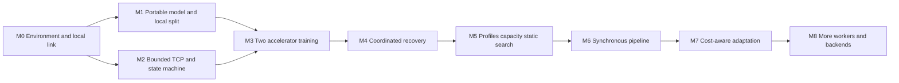

# Implementation plan

Status: 2026-10-11 (Asia/Kolkata). M1 reference, M2 transport and M3 real serial training implemented; 122 supplemental CPU/socketpair tests pass. Target-accelerator and LAN acceptance remain pending. M4–M8 remain proposed. Follow [SETUP](SETUP.md), [M1](M1.md), [M2](M2.md), and [M3](M3.md) for runnable commands.

## Shared drafting contract

- Project root: `/Users/utkarsh/Documents/hive-train`; initially empty, not a Git repository. No applicable prior AGENTS.md found.
- Native Windows CUDA / native ARM64 macOS MPS, same selected PyTorch base release; [SETUP](SETUP.md) owns Python/torch pins and verified wheel evidence. FP32, AdamW with foreach=False/fused=False, no AMP initially.
- Windows coordinator process plus separate CUDA worker; Mac MPS worker. Windows stage 0 owns embeddings and first blocks, Mac stage 1 owns later blocks, final norm and untied output head; orientation may be measured later.
- One Windows-bound TCP listener, port 29550, both workers initiate connections (CUDA via loopback). Coordinator relays boundary tensors. One persistent connection per worker; protocol 1; JSON metadata plus binary tensor bytes, never pickle. No other runtime ports.
- Fixed two-worker membership; one microbatch in flight; manual contiguous split; immutable parameter version throughout all microbatches of a step. Targets originate with deterministic Windows CPU data loader and are delivered to the loss-owning final stage.
- Microbatch loss uses sum of nonignored token losses divided by total valid tokens in the optimizer step. No additional gradient averaging. Each stage owns optimizer for its parameters only. All workers ready before STEP_APPLY; any uncertain partial update aborts the run and restores a complete checkpoint under a fresh run ID.
- Checkpoint each stage locally and commit a coordinator manifest only after all durable shards match step/version. No in-run rejoin or retry of optimizer application. No full model gathering on coordinator.
- Primary-source research; explicit evidence labels (documented, author-reported, personally tested, engineering inference, unverified). Access date 2026-10-07 local; do not invent target-machine results.

## Draft ownership (temporary)

| Role | Files | Status |
|---|---|---|
| A platform/setup | docs/SETUP.md, docs/research/PLATFORM.md | draft complete; independent integration review performed |
| B prior art | docs/RESEARCH.md | draft written; final agent turn interrupted by service usage limit; orchestrator integrated |
| C runtime | docs/ARCHITECTURE.md, docs/PROTOCOL.md | drafts written; final agent turn interrupted by service usage limit; orchestrator integrated |
| D profiling/evaluation | docs/FEASIBILITY.md, docs/VALIDATION.md | delegation attempted; service usage limit before draft; orchestrator completed |
| Orchestrator | AGENTS.md, README.md, PROJECT_SPEC, IMPLEMENTATION_PLAN, RISKS, DECISIONS, integration | completed research/planning integration and document checks; M0–M8 implementation/hardware gates pending |

Independent review is read-only; the orchestrator alone integrates cross-file corrections. Four specialist roles were used in two waves, at most three active specialists alongside the orchestrator. Interrupted work is not counted as completed agent research.

## Milestones and dependency order

M1 and M2 may be developed in parallel after interfaces are frozen. The required first implementation milestone is **M1**, with M0 setup checks as its entry gate. A local prototype may proceed on CPU while awaiting hardware, but does not satisfy accelerator acceptance.

### M0 — Record platform and local network readiness

Deliverables: `artifacts/environment/<machine>.json`, platform-specific resolved dependency records, wheel/source provenance, and local connection results. Record OS/build, CPU/accelerator, RAM, disk, Python architecture/version, torch release/build, driver, MPS availability, backend environment variables, power mode, and target test status.

Execute the exact setup diagnostics on each owner machine. Windows's selected driver need only support the chosen wheel; do not install a Toolkit to solve an unrelated connectivity or architecture error. Run peer echo on port 29550 with narrow firewall access. Capture a failed college-link result and hotspot result if isolation is suspected.

Acceptance: both selected accelerators complete forward/backward/AdamW without silent CPU fallback; peer TCP echo succeeds; exact environment is saved. Failures map to [RISKS](RISKS.md). No throughput or capacity claim yet.

### M1 — Implement the portable decoder and deterministic split reference

Inputs: [PROJECT_SPEC reference workload](PROJECT_SPEC.md#reference-workload-contract), [ARCHITECTURE autograd/ownership](ARCHITECTURE.md), [VALIDATION numerical suite](VALIDATION.md). No transport, external dataset, process group, custom kernels, or coordinator is needed.

Implemented M1 deliverables (target hardware acceptance still pending):

- `pyproject.toml`, `src/hive_train/config.py`, `model.py`, `initialization.py`, `reference.py`; `tests/test_model.py`, `test_split_autograd.py`, `test_accumulation.py`.
- A frozen configuration schema and canonical parameter naming shared by whole-model and stage factories. A stage constructor accepts `[start_block,end_block)` and endpoint ownership, creating only owned modules.
- Stable CPU initialization: SHA-256 UTF-8 `hive-train:init:v1:2026:<global_parameter_name>`, first eight bytes big-endian masked to 63 bits, independent `torch.Generator(device='cpu')` per parameter; module construction defaults are overwritten. Stream one tensor at a time. Store fixture hashes and initialization schema version.
- Unsplit CPU FP32 reference and same-process two-stage reference. The latter explicitly detaches/copies the boundary and returns leaf gradients, so local autograd cannot accidentally connect the stages.
- Synthetic next-token batches and masks with stable CPU RNG, config/state export, per-name loss/gradient/update comparisons, and one local device diagnostic command once implemented.

Tests: unsplit vs split with same initial state; every trainable parameter represented exactly once; per-name gradients finite/nonmissing; boundary gradient; first and repeated AdamW updates; K=2 unequal valid counts; one all-ignored microbatch within a nonempty step; reject all-empty steps; missing/stale boundary IDs fail; stage factory never constructs unowned blocks. Disable dropout and TF32 for equivalence. Test CPU first, then CUDA-only and MPS-only execution of both reference forms on their respective machines. Cross-device numerical thresholds are authoritative in VALIDATION.

Acceptance: the full tiny decoder runs locally forward/backward/update on both accelerators; local split matches its same-device unsplit reference under declared tolerances; exact CPU fixture produces recorded portable results; no unexplained parameter mismatch, fallback, or CPU-resident parameters/gradients/moments. Intentional CPU staging, optimizer scalar counters and metadata are permitted and recorded. Tests and short report can be run by a subsequent session without redesign. CPU-only success is partial until accelerator reports exist.

### M2 — Implement framing, bounded transport, and protocol state tests

Depends on M0 connectivity for target acceptance; local development parallelizable with M1. Implemented files: `protocol.py`, `transport.py`, `tensor_codec.py`, `state.py`, `transport_probe.py` and their tests, including `test_transport_state.py`. [PROTOCOL](PROTOCOL.md) is the sole wire/state authority; [M2](M2.md) documents APIs and runnable probe commands.

Implemented header validation before allocation, complete-read/write loops, tensor encoding, endianness conversion, limits and shape whitelists, auth, IDs and message/state validation, one writer per socket, no application queues, cancellation, EOF/deadline behaviour, and state-gated coordinator relay. No real optimizer updates in this milestone; fake callbacks record attempted side effects. Socketpair tests are partial acceptance, not LAN measurements or sustained memory evidence.

Acceptance: f32/i64 tensor round trips preserve values and bit patterns where specified; arbitrary fragmentation/coalescence works; invalid lengths/dtypes/shapes/IDs/auth and duplicate apply are rejected; stalled readers and partial frames terminate in bounded time; no unbounded RAM growth; LAN benchmark captures both directions with realistic sizes. Application-specific commands become runnable only after implementation and documentation update.

### M3 — Execute real two-machine training

Depends on M1 and M2. Implemented files: `coordinator.py`, `worker.py`, `runtime.py`, `train_cli.py`; diagnostic `local_run.py`, `diagnostics.py`, `snapshot_check.py`; reuses M1 `data.py`. Coordinator is CPU-only; workers own model/optimizer. Capabilities, deterministic manifests and data placement use protocol 1. Manual splits and K1..4 serial accumulation are implemented with all-ready/all-ack barriers and reused-version rejection. CPU implementation checks pass; target acceptance below remains pending.

Acceptance: actual Windows CUDA → Mac MPS forward and reverse gradient transfer; all parameters updated once per step; trace IDs/order reconcile; loss, all gradients, optimizer state and updates pass the reference suite; short training learns comparably over fixed batches. Record copies, network times and synchronized steps. A two-CPU emulation is useful but cannot pass this milestone alone.

### M4 — Coordinated checkpoint and restart

Depends on M3. Proposed files: `checkpoint.py`, `tests/test_recovery.py`. Implement local bounded tensor shards with hashes, durable completion receipts, coordinator manifest commit, data/RNG state, rollback and fresh-run resume. Checkpoint before first training step and each step for fault tests. Include model/config/partition/schema provenance and optimizer counters.

Acceptance: inject failures during forward, gradient transfer, between worker updates, after one acknowledgement, during shard writes, and before/after manifest completion. Restart only last complete version; compare resumed training to uninterrupted reference; corrupt/missing shards cannot load; peak save/restore memory remains bounded. Lost peer-local disks are explicitly unsupported unless backups are configured.

### M5 — Measure capacity and choose a static split

Depends on M4; profiling tools can be designed alongside M3/M4. Proposed files: `profile.py`, `planner.py`, benchmark config/manifests/results. Collect full-step peaks after Adam moments exist, stage compute, endpoint costs, transfer decomposition and sustained power/thermal behaviour. Enumerate each legal block boundary and both stage orientations, then a small b/T/K grid per fixed objective/batch. Reject memory-infeasible choices before expensive runs; validate finalists with actual full-stage execution.

Acceptance: [FEASIBILITY](FEASIBILITY.md) gates and [VALIDATION](VALIDATION.md) benchmark records complete; capacity success has a stable distributed run plus matched accelerator failures and separate CPU/offload assessment. If no capacity witness exists, publish the measured limit and refine the workload transparently. Static selection must choose a feasible measured candidate and report prediction error/regret against exhaustive observations; no claimed speed benefit without matched baselines. Protocol 1's initial role map is fixed; reverse-orientation profiling is offline until an explicit role-to-device mapping/schema extension is implemented and validated.

### M6 — Add bounded synchronous microbatch pipelining

Depends on M5 and updated protocol/config validation for a negotiated in-flight limit. First implement a flush schedule: forward K microbatches with explicit bounded credits, backward all of them, then one all-worker optimizer barrier. Keep weights fixed throughout the flush. Avoid a schedule whose retained graphs exceed measured memory; reduce K or add a separately validated 1F1B schedule. No next-version overlap.

Acceptance: K=2/4 matches serial gradient/update semantics; all graph and buffer bounds hold; recovery faults still abort safely; measured throughput and memory compare against M3 serial and best M5 static baselines under equal effective batch. Retain serial mode if the link or tiny compute makes pipelining slower.

### M7 — Adapt only when migration pays

Depends on M6 and state-preserving migration tests. Profile sustained drift, smooth estimates and uncertainty, then enumerate the same valid assignments. Use the explicit break-even rule in FEASIBILITY, a minimum residency/cooldown, and a no-change option. Drain and checkpoint the old plan; transfer parameters plus both Adam moments/counters under stable global names; validate new allocation and ownership; resume only after all ready. If migration fails, restore the old complete checkpoint under a new run ID.

Acceptance: predicted versus measured total migration cost includes draining, state transfer, de/allocation, warmup and resume; state equivalence across a move; no oscillation under jitter; predeclared constant/compute-drift/network-drift traces compared against manual static, profiled static, and clairvoyant offline reference (clearly unattainable diagnostic bound). An abstaining policy can pass correctness; performance contribution requires net gain after overhead with uncertainty reported. No RL required.

### M8 — Additional devices/backends

Depends on M7 or a separately justified scope change after M5. Extend topology/ownership manifests and multi-boundary scheduling; add backend capability adapters only for a concrete device with local backward/update support. Keep fixed membership first. Validate 3+ stages against CPU reference, memory ownership, global token normalization and coordinated checkpoints before elastic membership or public collaboration.

Acceptance: each new backend passes the existing suite; a three-stage run trains the same objective without centralized full-state storage; protocol version/capabilities are explicitly negotiated. Hardware not available is documented as untested.

## Parallel work rules for implementation

Model/reference (M1) and transport/state machine (M2) can have independent owners with disjoint files. Profiling design and fault-injection test design can proceed while M3 runtime is built. Runtime integration, schema changes, and protocol version changes have one owner. Share interface changes before merging; run the common numerical/protocol suite afterward. Agents do not edit shared root docs concurrently. Assignments are temporary and updated here each session.

## Definition of done for this planning run

All required documents exist, source-backed compatibility and prior art are distinguished from tests, protocol/backward/memory/recovery details agree, setup snippets do not reference absent scripts, and an independent review has been resolved. No complete training application is implemented. Actual testing and review outcomes are recorded in README and VALIDATION after integration.

## Independent review and integration log — 2026-10-07

Platform specialist performed two read-only review passes after initial drafts, including final FEASIBILITY/VALIDATION. The orchestrator integrated all findings:

- Explicit runtime `0.0.0.0:29550` binding for simultaneous loopback/LAN clients, with scoped external firewall and diagnostic/runtime distinction.
- Defined pre-configuration CAPABILITIES version as null and RUN_CONFIG version as starting_version, so checkpoint restart admission is well-defined.
- Allowed intentional CPU Adam scalar counters/metadata while keeping trainable tensors and moments on declared accelerators.
- Marked reverse-orientation profiling offline until role mapping is implemented; reconciled K notation, protocol message names and temporary statuses.
- Added bandwidth-only negative control for k-only migration and allowed mathematically structural zero gradients.

Reviewer found no further blocking backward, normalization, recovery, memory arithmetic, Wi-Fi, or capacity-baseline inconsistency. Review does not establish executable correctness or target hardware support. Orchestrator performed final Markdown-link, snippet-syntax, framing/arithmetic and cross-document checks; hardware gates remain pending.

## M1 implementation log — 2026-10-07

Orchestrator owns implementation and documentation changes; independent read-only code review completed by `m1_review`. Added stage factories, named initialization, portable causal decoder, detached local boundary, token-weighted accumulation and local optimizer barriers, reference snapshots/comparisons, doctor/verify/fixture commands and standard-library unittest tests. No M2 sockets or M3 distributed runtime was added. Review found and reproduced a KeyboardInterrupt hole between optimizer updates; fixed by poisoning the trainer before compute and clearing only after full success, with an interruption regression test. The reviewer otherwise confirmed ownership, autograd boundaries, normalization and substantive comparisons.

The Python 3.13 download failed due to restricted-environment DNS. Installed cached Python 3.11.15/PyTorch 2.13.0 dependencies into project-local `.venv-local` for supplemental CPU tests; no global installs. Selected Python/PyTorch pins remain unchanged. CPU reference scenarios passed; neither CUDA nor MPS is available in this process. Exact usage, reports and limitations are in [M1](M1.md). Next code step is M2, alongside obtaining actual M0/M1 target reports.

## M2 implementation coordination

Shared contract: implement protocol 1 unchanged unless an ambiguity needs an explicit documented clarification. No real optimizer execution or M3 training coordinator. Standard-library schema/framing/auth/state tests must run without torch; optional tensor adapter uses the existing local torch environment. `ProtocolError(code, detail)` is the common terminal exception; strict metadata validation precedes payload allocation. `Frame(metadata, payload)` owns a bounded writable bytearray on receive. Authenticated sessions validate run, identity and contiguous sequence; state gates validate step/microbatch/version before side effects. Socketpair is available locally; binding an IPv4 loopback listener is denied by the execution sandbox. Socketpair results must not be described as a TCP/Wi-Fi benchmark.

Completed ownership: schema specialist owned `protocol.py` and `tests/test_protocol.py`; state specialist owned `state.py` and `tests/test_state.py`; orchestrator owned transport, authentication, tensor adapter, relay/diagnostics, integration tests and all docs. Schema specialist independently reviewed the integrated state/transport work in two passes. No shared files were edited concurrently.

### M2 completion and review — 2026-10-08

Local suite: **97 tests pass** (19 M1, 14 protocol, 37 state, 3 tensor codec, 20 transport, 4 authenticated state/relay integration). Tested macOS 15.5 ARM64, Python 3.11.15/PyTorch 2.13.0 supplemental CPU environment. Source-hashed local test receipt: `artifacts/validation/m2-local.json`; ignored artifact, not a target-machine report. Selected deployment pins remain unchanged. No IPv4 bind is allowed by this sandbox, so TCP routing, Windows sockets/firewall and Wi-Fi remain untested.

Independent review found and resolved mixed-version heartbeat races and unbounded apply-ID history. Protocol 1 now explicitly derives apply IDs from run/step using UUIDv5, and allows adjacent update versions only for received PING/PONG during the barrier; outgoing versions remain strict. Regression tests cover crossed packets, a committed worker while its peer is pending, duplicate apply with a fresh authenticated frame sequence, bad authentication before apply, lost acknowledgment, interruption poisoning and sealed admission deadlines. Final reviewer found no unresolved code blocker. Clarified bounded pre-auth payload allocation and per-peer cap selection in documentation.

### M3 implementation checklist (completed locally; target execution pending)

1. Obtain actual M0/M1 accelerator reports and run M2's LAN probe in parallel with CPU development. Do not mark target acceptance complete without those reports.
2. Add `runtime.py`, `coordinator.py`, `worker.py` and launch CLI/tests, reusing M1 stage factories/initialization and M2 sessions/state gates; do not change wire messages casually. Follow [M2 integration order](M2.md#interfaces-for-the-next-implementation).
3. First execute one **real** FP32 forward/backward/AdamW step with two CPU worker processes and the CPU-only coordinator, manual cut 2, b=2/T=32/K=1. Dataset/targets originate on coordinator; no model or optimizer ownership there. Supply manifest hashes, actual valid-token counts, deterministic apply IDs and bounded phase deadlines. Compare loss, every gradient, parameters and Adam moments/counters against M1 unsplit reference under CPU tolerances.
4. Add ten repeated steps and serial K=2 masked accumulation, malformed/bad-payload and disconnect integration tests. A failed run exits without retry; until M4 exists only deterministic fresh initialization is supported, never promise checkpoint resume. Keep training snapshots restricted to the tiny diagnostic fixture, not a general full-model gather.
5. Run identical logic on Windows CUDA + Mac MPS with fallback disabled; verify placement/synchronization, mixed-backend reference thresholds and short-learning acceptance in VALIDATION. CPU emulation cannot pass this target gate. Stop before implementing M4 recovery or M5 optimization without their own validation.

Runtime/CLI integration has one owner. Independent agents may own CPU-vs-reference integration tests and fault tests in disjoint files; a read-only integrated review is required before handoff. M3 passes only with actual target joint training and the stated numerical/learning checks, not just successful message exchange.

### M3 integration log — 2026-10-11

Worker specialist owned `worker.py`/`test_worker.py`; integration specialist owned `test_runtime.py`; orchestrator owned shared runtime/coordinator, launchers, diagnostic snapshots and docs. Service limits interrupted initial specialist turns; resumed work and independent read-only integrated review completed. The orchestrator integrated a plain-string torch version for strict wire metadata, consistent STOP success status, full phase receive deadlines and per-peer heartbeat version handling. Review also identified an evaluation-start collision and missing snapshot-replay bounds; the reserved pattern start is now excluded from training, initial distributed evaluation uses actual pre-update worker state, and replay enforces K1..4, config/run/stage IDs and counters.

Evidence: 122 tests pass (prior 97 + 6 real runtime tests + 16 worker tests + 3 diagnostic tests), including 30 real threaded-worker steps across all cuts. Separate Python worker processes passed ten K1 and ten masked K2 steps against the reference, plus a 100-step synthetic-pattern run. Pattern evaluation decreased 5.587015→4.377883 and matched reference. `artifacts/validation/m3-local.json` records source hashes and environment; `m3-process-single.json`, `m3-process-masked.json`, `m3-process-learning.json` hold process results. No actual target GPU, Windows shell, IPv4 TCP, Wi-Fi, checkpoint restore, capacity or speed result is claimed.

### Next: target M3 evidence, then M4 checkpoint recovery

Use [M3](M3.md) to launch coordinator/CUDA/MPS, collect exact environments and diagnostic snapshots, and compare the final step to the CPU reference. Run one/ten-step and K2 variants plus VALIDATION's short-learning checks. The selected package pair, target memory, local link and thermal behaviour remain nonblocking development assumptions but required hardware evidence.

Next code milestone is M4: stage-local bounded binary checkpoint shards, durable completion receipts, small coordinator manifest, fresh-run restart from the last complete version, and interrupted-run comparison against uninterrupted training. Reuse tensor validation but do not treat M3's overwritten diagnostic snapshots as checkpoints. Fault tests must cover partial worker updates, shard write failures and incomplete manifest publication; no uncertain-step replay or full-model assembly on coordinator.

### MPS numerical investigation — 2026-10-20

User Terminal evidence confirms one-step split-2 MPS execution passes three scenarios in the supplemental Python 3.11.15/PyTorch 2.13.0 environment, with fallback disabled. The ten-step all-cut invocation fails a key-bias update L2 gate; target M1/M3 acceptance remains pending. The orchestrator owns scoped verifier/CLI failure diagnostics, regression tests, and documentation integration. No additional agent work, model/protocol/optimizer changes, or threshold revision is involved. MPS is still unavailable inside the execution sandbox; a fresh diagnostic report must come from the user's normal Terminal. See [M1 investigation](M1.md#mps-investigation--2026-10-20) for evidence and the rerun command.

Validation in the existing macOS 15.5 ARM64 Python 3.11.15/PyTorch 2.13.0 CPU environment: all 126 tests pass (12.420 s), including four new checks covering preserved failure/exit status, elementwise error location, a small-update L2 rejection, and FP64 key-bias invariance. This is diagnostic/CPU evidence, not MPS acceptance.

Follow-up evidence localizes the old key-bias update failure to split 1, masked scenario, step 8, with gradient norms near 1e-10 and max absolute update difference below 5e-7. The orchestrator implements the scoped `decoder_v2` algebraic evaluation revision and integrates authoritative spec/architecture/protocol/decision updates (D15). Parameter ownership, names, initialization, optimizer policy and numerical thresholds are preserved. The new architecture identifier changes config hashes and rejects old evaluation configurations/snapshots. The source remains shared by CPU/CUDA/MPS; no device-specific workaround is introduced. Independent forward/derivative checks use a conventional biased-attention reference in CPU FP64, and regression coverage requires exact-zero key-bias gradients plus intact optimizer state and weight decay. Target MPS validation must still run outside this sandbox; M4 remains out of scope.

Revised-evaluation CPU validation: 130 tests pass (13.242 s) in the same supplemental environment. A fresh 100-step process-isolated pattern run passes all-step reference comparisons, with worst absolute error 0 and validation loss 5.587015151977539 → 4.366931438446045. Evidence: `artifacts/runs/decoder-v2-20261020-5x9r930z/cpu-pattern.json`. Two independent CPU worker processes each committed 100 steps; this is not TCP/Wi-Fi, GPU, capacity or speed evidence. The subsequent report-only addition labels the evaluation revision explicitly in environment reports.

### Explicit optimizer-sensitivity experiment — 2026-10-20

User Terminal evidence: all nine ten-step `decoder_v2` MPS same-device cases pass at default epsilon 1e-8. CPU-reference comparison still fails the elementwise parameter gate at one ordinary MLP weight on the first masked step. CPU FP32 versus FP64 replay reproduces the failing CPU coordinate and demonstrates near-zero gradient sensitivity; the epsilon-1e-6 replay reduces that coordinate's parameter difference from 2.258e-4 to 2.929e-6. This motivates a separate experiment, not a silent optimizer/tolerance change or a claim of original-workload acceptance.

The orchestrator owns an explicit `--adam-eps` option for M1 verification and M3 coordinator configuration, bounded worst-coordinate failure details, tests and shared document integration. Both compared trainers/workers and snapshot replay use the same recorded/hashed epsilon. Default epsilon and thresholds are unchanged. All 133 CPU tests pass (12.834 s), including nondefault epsilon propagation through real workers and snapshot verification, invalid-value rejection and numerical-sensitivity coverage. The full CPU nine-case ten-step epsilon-1e-6 run passes. See [M1 evidence](M1.md#cross-device-optimizer-sensitivity) and D16. No delegation, threshold revision, M4 implementation or GPU experiment is claimed; fresh MPS epsilon-1e-6 reports remain required before judging that configuration.

Follow-up user evidence at 07:29:03 UTC: `artifacts/validation/m1-mps-v2-eps1e-6-vs-cpu.json` passes all nine cases/90 compared steps on MPS versus CPU at epsilon 1e-6, with fallback disabled in the supplemental Python 3.11.15/PyTorch 2.13.0 environment. The orchestrator inspected the report and recorded source/config hashes in M1. Same-device MPS at epsilon 1e-6, Windows CUDA, LAN probes and actual joint training remain pending; the default epsilon-1e-8 cross-device failure remains recorded. Only documentation changed in this follow-up, so the numerical suite was not rerun.

Follow-up user evidence at 07:31:50 UTC: `artifacts/validation/m1-mps-v2-eps1e-6.json` passes all nine same-device cases/90 compared steps. The orchestrator inspected both epsilon-1e-6 reports and verified matching source/config hashes, all split/scenario combinations, ten steps per case and fallback disabled. Local Mac numerical checks are complete for this supplemental configuration. Windows CUDA, authenticated LAN probes and joint training remain the next hardware gates; neither the original epsilon-1e-8 CPU-reference gate nor the selected deployment pair is marked complete. Documentation-only evidence update; no tests rerun or training defaults changed.

Selected-pair follow-up at 08:43:31/08:50:26 UTC: user-run MPS/MPS and MPS/CPU suites each pass nine cases/90 compared steps in `.venv` with Python 3.13.14/PyTorch 2.11.0, `decoder_v2`, explicit epsilon 1e-6, fallback disabled. The orchestrator inspected both full `m1-mps-torch211*.json` reports, verified planned-package matching and shared source/config hashes, and recorded details in M1. Local Mac numerical checks are complete for this configuration. The user reports Windows Python 3.13.16/PyTorch 2.11.0 CUDA 12.8; CUDA test results remain required. Next: Windows checks, authenticated LAN probe, then M3 target training and snapshot comparison. Only documentation changed in this follow-up; no defaults, thresholds or code were modified.
